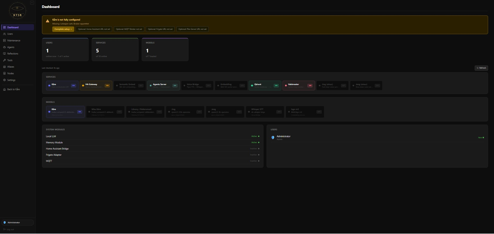

# Kåre The Smart Butler


[](https://buymeacoffee.com/dursnif)

**The AI layer your smart home is missing.**

---

## Why does this exist?

Most local AI projects are built by developers, for developers. They require you to live in the terminal, copy-paste cryptic commands, and edit complex config files just to get a basic feature working. If you don't know how to code, setting up a private, local AI agent network feels impossible.

**KTSB was built to change that.**

The creator of KTSB didn't know how to code either — still doesn't, and has never written a single line of it. The project started in June 2025: about eight months of ChatGPT copy-paste between terminal and chat, then Claude from late February 2026, and Claude Code directly in the terminal from April 2026. It was born out of pure frustration with how uncomfortable, difficult, and text-heavy the local AI landscape is for regular people — and the conviction that architecture, decisions, and years of frustration are still ownership, even without a single commit written by hand.

KTSB is built for **the average user**, not the terminal-comfortable developer: full access to the most advanced AI agent features spoken about today — completely free for private use, entirely local, and managed 100% through a beautiful, intuitive web GUI.

No terminal required after the initial setup. No configuration files to edit manually.

KTSB fits seamlessly alongside your existing **Home Assistant** and **Frigate** setup, running on its own dedicated machine and connecting to both over the network — each system keeps doing what it already does best.

And because it's yours, you decide how deep you go: tune the personality, prompts, and model choices yourself, or just use the ready-built defaults and start talking.

- Understanding what you say in natural language
- Controlling your smart home through Home Assistant
- Analysing camera footage through Frigate
- Answering questions, setting timers, searching the web
- Remembering your preferences and conversations over time



---

## What can the main agent do?

KTSB's main agent is called *Kåre* by default — you can give it any name under **Settings → Assistant Settings**.

### Talk and understand
Ask the main agent anything in natural language — by voice or text. No rigid commands, no keyword memorisation. *"Turn off everything downstairs and lock the door"* works just as well as *"lock front door"*.

The GUI supports **Norwegian, English, and German**. The assistant name, hot-word, and response language are all configurable.

### Control your smart home
The main agent connects to Home Assistant and can control anything HA knows about: lights, locks, thermostats, covers, media players, scenes, and scripts. You define your own room names and device nicknames so you can say *"the lamp in the corner of the bedroom"* and the main agent knows exactly what you mean.

### See through your cameras
Ask *"is there anyone outside?"* or *"what happened at the front door in the last hour?"* and the main agent checks your Frigate cameras and describes what it sees. Motion events and snapshots can be analysed automatically and announced over your speakers.

### Remember and learn
The main agent maintains a short-term memory of your recent conversations and a long-term memory that persists across sessions. It builds a self-image over time based on its interactions — the longer you use it, the better it knows you. Its own notes are sorted into drawers — short follow-ups, observations, lessons it always keeps in mind, and topics it has settled — so old notes do not crowd out the conversation.

### A team of AI assistants
Behind the scenes, the main agent has a small team working alongside it:

- **Miss Kåre** — a quiet evaluator who reviews the main agent's answers before they reach you
- **Mechanic** — a technical assistant for deep-dives, system inspection, and complex problems
- **Miss Library** — searches a local Wikipedia corpus and the web for factual answers
- **Jing and Jang** — background inner voices that process and reflect while you are not watching

Every night (03:00 by default, set under **Settings → Reflection**) a night sequence runs in order: memory compression, a weekly review of what the main agent believes about the world, a reflection meeting that reviews the day, and a dev slot that investigates problems with read-only tools and leaves proposals for an admin to confirm in chat. Nothing changes without that confirmation.

### Multi-user with proper access control
Create separate accounts for everyone in your household. Each user gets a PIN, a role (Child, Teen, Young adult, Adult, Admin), and their own memory and conversation history. Sensitive tools — web search, system inspection, camera access — are gated by role.

Remote access via WireGuard VPN is available as an optional service, with per-user access levels: local only, AI chat only, or full smart home access from anywhere.

### Flexible AI backend
KTSB uses **Ollama** for local LLM inference out of the box. No cloud account required. Models can run on this machine or on another machine in your network — point each role at its address under **Settings → LLM**. With a 24 GB GPU you can run the 27B as the main agent (in Ollama, or vLLM for more speed) for the full experience. A cloud provider (OpenAI-compatible, HuggingFace, NVIDIA NIM …) can be added for explicit «ask online» questions; it does not run the main agent's tools (smart home, memory, cameras) yet.

---

## What you need

KTSB runs via **Docker**, which means it works on Linux, Windows, and macOS without installing anything else manually.

| | Minimum | Recommended |
|---|---|---|
| **OS** | Linux, Windows 10/11, macOS | Linux (native Docker, fastest) |
| **RAM** | 8 GB | 16 GB+ |
| **Disk** | 20 GB free | 60 GB+ (for AI models) |
| **GPU** | Not required (basic mode) | NVIDIA with 24 GB+ VRAM (full main agent, 27B) |

### What to expect from the model you run

Be honest with yourself about this one — it decides what the main agent can do:

- **27B on a 24 GB+ GPU — KTSB as intended.** The main agent picks the right tool, controls the house, remembers, searches, and tells you when it doesn't know.
- **9B or smaller (the default on a fresh install) — basic mode.** Conversation works. Tool use is unreliable: it may skip a search, pick the wrong tool, or claim to know things it has no source for. On CPU only, the first answer after start can take several minutes; later answers about a minute.
- **Cloud** — only for explicit «ask online» questions today; it does not run the main agent's tools.

A smaller model is a way to try KTSB, not the finished experience. A tuned KTSB-sized small model is on the roadmap.

**No Home Assistant or Frigate?** That is fine too. KTSB works as a standalone AI assistant and you can add integrations whenever you are ready.

**Already running Home Assistant or Frigate?** KTSB's own code is lightweight — it is the LLM behind it that is demanding. Running KTSB on the same machine as Home Assistant or Frigate can cause KTSB to introduce delays on those systems instead of the other way around. A separate machine, even a modest one, keeps everything responsive.

### What's actually been tested

This is a one-person hobby project, not a company with a QA team. Here is what we actually ran, and — just as
important — what we did not.

**Where it runs every day:** the developer's own house, on Linux with two NVIDIA GPUs. That install runs
**directly on the machine (systemd), not in Docker**, with the 27B main agent described under *What we run
ourselves*. Every feature in this release has run there first.

**How we tested the Docker release:** on a separate Windows 11 PC with Docker Desktop (WSL2), an AMD laptop
CPU, 32 GB RAM and **no dedicated GPU**, in October 2026, before this release:

- upgrading a real v1.9 install (data, users and settings kept) and a fresh install from scratch
- the default 9B model on that CPU, and a 27B main agent running on another machine in the same network
- backup → wipe → restore, a server using its own Ollama instead of the built-in one, several users at once
- all containers starting at once on old and new configs, and two settings saved at the same moment
- an attempt to get in from another machine on the network: login limits, default PIN, open endpoints, ports
- the night sequence started by hand and started by itself
- voice in the browser over HTTPS through the bundled Caddy

More than 30 real bugs were found this way and fixed before the release, four of them security holes. The
fixes are in the release notes. The last check ran on the release-candidate images from GitHub, on the same
PC: an upgraded v1.9 install and a fresh install from the release file. It found one more bug — `setup.ps1`
did not start in Windows PowerShell 5.1, the version Windows ships with (also in v1.9) — fixed in this release.

**What we have not tested:**

- **macOS** — never installed on a Mac. It is Docker, so it should work, but nobody has checked — and from
  reading the code, `setup.sh` uses Linux-only shell features that macOS's default shell lacks.
- **A GPU in Docker from a fresh install** — the GPU machine runs KTSB outside Docker. The Docker test PC has no
  NVIDIA GPU, so `setup.sh`'s GPU setup and Ollama on a GPU inside Docker are untested.
- **The update button from one release to the next** — we tested it with stand-in releases; the first real
  update happens when the next release comes out. If it fails, it rolls back to the version you had.
- **Pulling a model from the GUI on a fresh Docker install** — our test reused models already downloaded.
- **Long-term running** — the new memory drawers, answer checks and dev-slot themes have run for days, not
  weeks. The dev slot itself ran 8 nights in the developer's house; in Docker the night sequence has only run a
  few nights.

**Known issues in this release:**

- On CPU only, the 9B backup model can time out (120 s) when it starts cold, so the fallback fails.
- Right after you switch language, the main agent may keep answering in the old one for a while.
- A 27B model can say it did something without doing it, or write a tool call as plain text instead of running
  it; the answer check catches the common phrasings, not all.
- In onboarding, «External LLM server» sets every role to the Ollama API. For vLLM, LM Studio or another
  OpenAI-compatible server, change the provider afterwards under **Settings → LLM / Models**.
- A per-user reply language is not active yet: everyone gets the household language unless they ask otherwise.
- After an update, reload the page if the GUI still looks like the old version (the browser may cache it).

If you hit a problem, especially on macOS or a GPU install, [open an issue](https://github.com/Dursnif/KTSB/issues).

---

## Getting started

### Step 1 — Install Docker

Docker is a tool that packages software into self-contained boxes that run the same way on any computer. You do not need to install Python, databases, or any other programming tools — Docker handles all of it.

**Windows:** Download and install [Docker Desktop](https://www.docker.com/products/docker-desktop/). During installation it will ask you to enable WSL 2 (a Linux environment that runs inside Windows — Docker needs it) — say yes. Restart your computer when prompted.

After restarting, **open the Docker Desktop application itself** (find it in your Start menu, not just a terminal) and wait for it to say "Docker Desktop is running" — this can take a minute. Every command in the steps below needs Docker Desktop actually open and fully started first, not just installed — running a command too early gives a confusing error instead of a clear "Docker isn't running" message.

> **If Docker Desktop shows an unclear error instead of asking about WSL 2 during install:** this happened during our own testing — Docker Desktop doesn't always prompt for WSL 2 automatically. Open PowerShell **as Administrator**, run `wsl --install`, restart your computer, then open Docker Desktop again.

**macOS:** Download and install [Docker Desktop](https://www.docker.com/products/docker-desktop/). Open it once to finish setup, and — same as Windows — make sure it shows as running before continuing.

**Linux:** Follow the [Docker Engine install guide](https://docs.docker.com/engine/install/) for your distribution. For NVIDIA GPU support, also install the [NVIDIA Container Toolkit](https://docs.nvidia.com/datacenter/cloud-native/container-toolkit/install-guide.html).

Verify Docker is working by opening a terminal and running:
```
docker --version
```
You should see a version number. If you get an error, make sure Docker Desktop (Windows/macOS) is open and shows as running — not just installed.

---

### Step 2 — Download KTSB

Open a terminal — **PowerShell** on Windows, **Terminal** on Mac or Linux — and run:

```bash
git clone https://github.com/Dursnif/KTSB.git
cd KTSB
```

> **No git?** Download `ktsb-docker-<version>.tar.gz` from the [latest release](https://github.com/Dursnif/KTSB/releases/latest), unpack it, and open a terminal inside the folder. (Use the release file, not GitHub's «Download ZIP» — the ZIP carries no version, so the update button stays off.)

---

### Step 3 — Run setup, then start KTSB

The setup script checks your hardware (GPU or CPU), asks whether to include the built-in Ollama, writes `.env`,
and makes the folder updatable from the GUI later. Answer **yes** when it offers to convert the folder.

**Linux / macOS:**
```bash
./setup.sh
docker compose up -d
```

**Windows (PowerShell):**
```powershell
powershell -ExecutionPolicy Bypass -File .\setup.ps1
docker compose up -d
```
(Windows blocks scripts by default; `-ExecutionPolicy Bypass` allows this one script, this one time. We ran it
on Windows 11 with scripts blocked, in Windows PowerShell 5.1.)

Docker Compose 2.20 or newer is needed — Docker Desktop and current Docker Engine already have it.

The first start downloads the Docker images (about 5 GB). This takes a few minutes depending on your internet speed. You only need to do this once — future starts are instant.

Watch the progress:
```bash
docker compose logs -f
```
Press `Ctrl+C` to stop watching logs. The services keep running in the background.

---

### Step 4 — Open the browser

Go to **http://localhost:5173/login** in your web browser.

Log in with the default admin credentials:

| Username | PIN |
|----------|-----|
| `admin` | `1234` |

> ⚠️ **You will be forced to change the PIN on first login.** Do not skip this — the default PIN is public knowledge.

The onboarding wizard walks you through the rest — no config files to edit manually:

1. **Profile** — your assistant's name, language, timezone, and location (used for weather)
2. **User** — create your personal user account with a PIN (min. 6 digits)
3. **Distribution** — choose how much of the system to enable (start with *Medium*)
4. **LLM source** — the built-in Ollama, or your own Ollama server elsewhere in the network
5. **Integrations** — connect Home Assistant (URL and token), Frigate, and others (you can skip this and do it later)
6. **Done** — install your first AI model and start chatting

---

## Connecting Home Assistant

In the KTSB admin panel, go to **Settings → Home Assistant**.

You need two things from your Home Assistant install:

**1. The URL** — the address you use to open HA in your browser. Usually something like `http://homeassistant.local:8123` or `http://192.168.1.x:8123`.

**2. A long-lived access token** — this gives KTSB permission to control HA on your behalf.

To create one: in Home Assistant, click your profile picture in the bottom-left corner → **Security** → scroll down to **Long-lived access tokens** → **Create token** → give it a name like *KTSB* → copy it and save it somewhere safe.

Paste the URL and token into **Settings → Home Assistant** in KTSB and save. That is it.

**Setting up device names** — the main agent understands room names and device nicknames you define yourself. Open the **Aliases** page to map your own names (like *"the bedroom lamp"*) to Home Assistant entity IDs. The alias editor has a search function to help you find the right entity.

---

## Connecting Frigate

In KTSB admin, go to **Settings → Integrations → Frigate**.

You need:
- **Frigate URL** — the address of your Frigate instance (e.g. `http://192.168.1.x:5000`)

For real-time motion event detection, also connect **MQTT** under **Settings → MQTT/VPN** with your broker address and credentials. This lets the main agent react to Frigate events as they happen.

Go to **Settings → Images/Camera** to configure which cameras the main agent should monitor, what objects to watch for (people, cars, animals), confidence thresholds, and whether to announce detections over your speakers.

---

## Choosing an AI model

After the onboarding wizard, open **Settings → LLM / Models**, expand **Manage model** on a role's card, paste the
model name from [ollama.com](https://ollama.com) and click **Pull model**. No command line needed.

| Your GPU VRAM | Recommended model | Size | How we have used it |
|---|---|---|---|
| No GPU (CPU) | `huihui_ai/qwen3.5-abliterated:2b` | 1.9 GB | Not tested by us as the main agent — expect very limited tool use |
| 4–6 GB | `huihui_ai/qwen3.5-abliterated:4b` | 3.3 GB | Ran Miss Library in our tests; not tested as the main agent |
| 8–16 GB | `huihui_ai/qwen3.5-abliterated:9b` | 6.6 GB | Runs Miss Kåre, Mechanic and Miss Library in our house every day; the fresh-install default (basic mode as main agent) |
| 24 GB+ | `huihui_ai/Qwen3.6-abliterated:27b` | 17 GB | Our main agent until August 2026 — the full main agent (see *What to expect* above) |

A fresh install expects `huihui_ai/qwen3.5-abliterated:9b` for every role (main agent, Miss Kåre, Library, Mechanic) on the built-in Ollama — pull that one first. One model for all roles uses less memory and keeps things simple. On a smaller machine, switch all roles to a smaller model instead; with a 24 GB+ GPU you can move Kåre to the 27B. You can assign each agent its own model later under **Settings → LLM**.

**Why abliterated models?** KTSB is a multi-agent system — agents evaluate each other, inspect logs, and ask sensitive questions internally. Standard models can refuse these internal requests, breaking the pipeline. Abliterated variants have the refusal direction removed, which makes the whole system more reliable. Abliteration is not one method: variants differ in how much they change the model, and a heavier edit can cost quality. The recommendations above are from [huihui_ai on Ollama](https://ollama.com/huihui_ai) because they are easy to pull and we have run them.

**What we run ourselves.** The house KTSB is developed in runs a different main agent than the table above: `orcarouter/Qwen3.8-27B-Uncensored` — a Qwen3.8 27B with a single refusal direction removed, ranked first in a public comparison of 12 abliterated Qwen3.8-27B variants ([abliterlitics.dev](https://abliterlitics.dev), October 2026). We quantized it ourselves to NVFP4 for vLLM, calibrated on KTSB-shaped conversations (system prompt, tool definitions, thinking and tool calls — no user data), Norwegian Wikipedia text and some English and German chat, so Norwegian stays clean after quantization; the model's speculative-decoding (MTP) head is kept for speed. This build is **not published**, and NVFP4 needs an NVIDIA Blackwell GPU — so it is not in the table, and nothing in KTSB depends on it.

**Multimodal:** All recommended models understand both text and images. For the full agent setup — main agent, Miss Kåre, Library, and Mechanic — using the same multimodal model across all roles ensures camera snapshots and images can be passed between agents without gaps.

**Extended thinking:** Qwen3 models can pause and reason before answering complex questions. Enable it per role under **Settings → LLM**.

**Prefer cloud?** Under **Settings → LLM / Models**, the cloud role takes an address and API key for OpenAI, NVIDIA NIM, or another OpenAI-compatible provider. It answers only explicit «ask online» questions and has no tools.

---

## Voice input

Browsers require HTTPS for microphone access. For voice input to work, KTSB needs to be served over HTTPS.

KTSB includes **Caddy**, which obtains a free Let's Encrypt certificate automatically. You will need a free dynamic DNS hostname from [DuckDNS](https://www.duckdns.org/).

1. Create a free account at [DuckDNS](https://www.duckdns.org/) and register a subdomain — e.g. `mykaare.duckdns.org`
2. Set it to point to your home's public IP address (shown on the DuckDNS dashboard)
3. Open ports **80** and **443** in your router (search for *port forwarding* in your router's manual)
4. Open your `.env` file and set `KAARE_DOMAIN=mykaare.duckdns.org`
5. Restart: `docker compose up -d`

Voice input will work as soon as the certificate is issued — usually within 30 seconds of first start.

Access KTSB at `https://mykaare.duckdns.org` from any device on your local network.

> For local use without voice, the default `KAARE_DOMAIN=localhost` works fine.

---

## Service profiles

Set `COMPOSE_PROFILES` in your `.env` file to control which optional services start:

| Value | What starts | When to use |
|---|---|---|
| *(empty)* | Core: API, GUI, HA gateway, semantic memory service, Qdrant, SearXNG, Caddy, night runner, updater | You run your own LLM server elsewhere |
| `ollama` | + Built-in Ollama LLM server | The default; leave it out when you use your own server |
| `medium` | + BGE-M3 embedding service | Local wiki search, Argus search, better «Relevant now» |
| `full` | + Voice bridge (speech-to-text, text-to-speech) and BGE-M3 | When you want voice input and output |
| `vpn` | + WireGuard (wg-easy) | Remote access, see below |
| `inner_voices` | + Jing and Jang | Optional background inner voices |

```
# .env — what setup writes (ollama,full when it finds a GPU)
COMPOSE_PROFILES=ollama,medium
```

---

## Remote access (VPN)

To access KTSB securely from outside your home network, enable the built-in WireGuard VPN service.

**Requirements:** a public hostname (DuckDNS recommended — you can reuse `KAARE_DOMAIN`) and UDP port 51820 open in your router.

### Setup

1. Open port **51820 UDP** in your router's port forwarding settings.
2. Generate a password hash for the VPN management web UI:
   ```bash
   docker run --rm ghcr.io/wg-easy/wg-easy:15 wg-easy --hash YourPassword
   ```
3. Add to your `.env` file:
   ```
   WG_HOST=mykaare.duckdns.org
   WG_PASSWORD_HASH=$$2a$$12$$...   # note: $$ escapes $ in Docker .env files
   ```
4. Add `vpn` to `COMPOSE_PROFILES` in `.env`:
   ```
   COMPOSE_PROFILES=medium,vpn
   ```
5. Restart: `docker compose up -d`

The VPN management UI is now available at `http://your-machine-ip:51821`. Add a client there, download its config or scan the QR code, and connect from your phone or laptop.

Once connected via VPN, KTSB detects you automatically as a VPN user.

### Per-user access levels

In **Admin → Users**, set each user's remote access level:

| Level | What it allows |
|---|---|
| **Local only** | Access only from your home network |
| **AI chat only** | Full chat and memory over VPN, no smart home control |
| **Full access** | All features available remotely |

New users default to **Full access**. Restrict individual users under Admin → Users if needed.

> **Note:** The VPN service requires `NET_ADMIN` and `SYS_MODULE` kernel capabilities. These work on standard Linux hosts. Some cloud VPS providers restrict kernel modules — check your host's documentation if wg-easy fails to start.

---

## Updating

From v1.10, update from the GUI: **Maintenance → Update KTSB**. It checks GitHub for a newer release and, after
you enter your PIN:

1. saves a backup point (marked «automatic», it does not count against your five),
2. checks that the release files and images are signed by KTSB's own release workflow,
3. downloads the new images while KTSB keeps running, then switches over,
4. checks that KTSB answers with the new version — and puts the previous version back by itself if not.

The button needs an install made with `setup.sh` / `setup.ps1` (Step 3). Updates are never installed on their
own, and never while the night sequence runs.

Your configuration, state, and data live in folders outside the Docker images and are kept. On the first start
of a new version, KTSB adds any new settings to your files in `configs/` — your own values and comments stay. KTSB
copies the whole folder to `configs/.history/_snapshots/` first, and every save from the settings pages
keeps the previous version of that file in `configs/.history/<file>/` (the newest 20 per file).

After an update from the GUI, the first time you run `docker compose up -d` yourself, Docker Desktop recreates
every container once. That is expected.

### Updating from v1.9 or older (once)

Getting from v1.9 to the update button takes one manual update — run these in your KTSB folder:

```bash
git pull
./setup.sh              # Windows: powershell -ExecutionPolicy Bypass -File .\setup.ps1
docker compose up -d
```
Answer **yes** when setup offers to make the install updatable. We tested this on Windows with a v1.9 install
that had changed settings, two users and encrypted chat history: settings, logins and memory were all kept.

Your settings are kept. The GUI keeps your configuration in `configs/` and the shipped templates live in
`configs_default/`; files you never changed are replaced by the new templates on the first start, files you changed
stay exactly as you left them (a copy of the folder is saved to `configs/.history/_snapshots/` first).
Setup keeps your git history as `.git-before-ktsb-updater` — after that, updates come from the GUI, not `git pull`.
If you edited `docker-compose.yml`, move your changes to `docker-compose.override.yml` first; setup warns you.

If you use speakers on your network (ESP32, Chromecast, Home Assistant media players), set
*Settings → LLM / Models → Piper → LAN address for speakers* once after the upgrade — Docker cannot detect it.

---

## What stays home, and what goes out

KTSB runs on your own hardware. **Conversations, memories, camera images and user data never leave your
machine** — unless you set up a cloud model and ask it something explicitly.

Some things do go out with the default settings, because the feature cannot work otherwise:

- **Web search** — the search words go to public search engines (through the bundled SearXNG), and KTSB then
  opens the pages it found. When a question is about your area, the town or country from your settings is
  added to the search.
- **Weather** — your location (latitude and longitude) goes to the weather service when someone asks.
- **Update check** — when an admin opens the Maintenance page, KTSB asks GitHub whether a newer release exists.
- **First voice start** (`full` profile) — the speech models download from Hugging Face.

One more, which is not needed and will go: the web interface loads its fonts from **Google Fonts**, so your
browser contacts Google when you open KTSB. The next release ships the fonts with KTSB itself.

Everything else that reaches the internet — cloud model, image generation, Brave Search, Norwegian law, tide
data, model downloads, a HTTPS certificate — happens only after you switch it on or click it. The full list,
with how to switch each one off: [docs/capabilities.md](docs/capabilities.md#what-leaves-your-machine).

---

## For developers

Code-mounted mode — edit files on disk without rebuilding images:

```bash
docker compose -f docker-compose.yml -f docker-compose.dev.yml up -d
```

Edit a Python file → `docker compose restart kaare-api` (~5 seconds) → done.

For a full breakdown of every feature, agent, tool, and service profile: [docs/capabilities.md](docs/capabilities.md)

---

## Project layout

```
configs/        ← Your configuration, written by the GUI (YAML + .env secrets) — not in git
configs_default/ ← Shipped templates; missing files are copied into configs/ on start
state/          ← Runtime state and databases (users, memory, knowledge, timers, Qdrant, backups)
models/         ← Models downloaded from the GUI (speech, semantic memory)
logs/           ← Service logs
kaare_core/     ← Shared Python library
services/       ← Embedding, voice, agents
frontend/       ← React/Vite GUI (TypeScript)
```

---

## License

[MIT](LICENSE)
